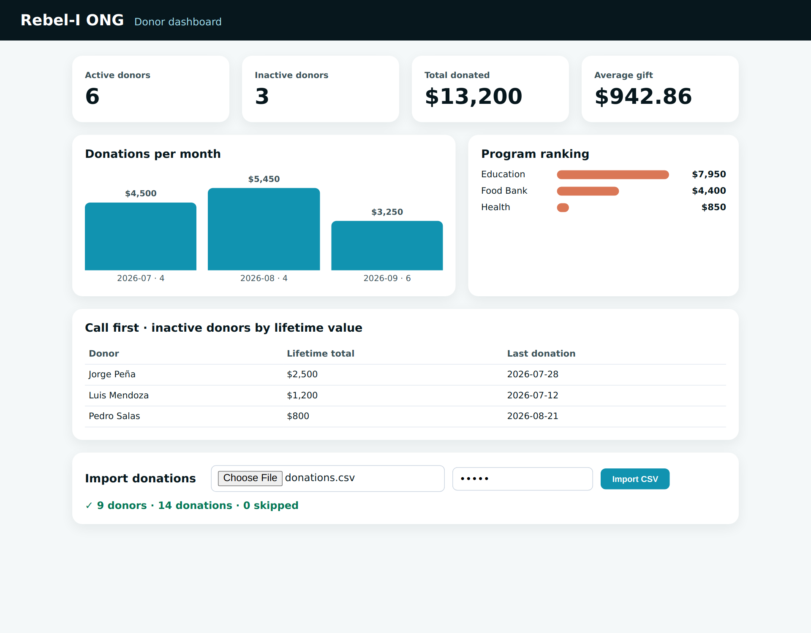

# MVP with Spec-Driven Development

A hands-on course on **Spec-Driven Development (SDD)** with AI coding agents (Claude Code, Codex, GitHub Copilot, Cursor, and others), using **[OpenSpec](https://github.com/Fission-AI/OpenSpec)**.

By La Rebelion Labs, presented by Roby-Lion and the crew: Hapi (specs), Cody (code), OrcA (tests), and Clooney (ops and release).



## What you build

A donor dashboard MVP for **Rebel-I ONG**, a fictional non-profit:

- KPI cards: active donors, inactive donors, total donated, average gift
- A monthly donations trend and a program ranking
- A CSV import protected by an admin key, which skips and counts bad rows
- A "call first" list of inactive donors, sorted by lifetime value

It is built in **three OpenSpec changes**. The result is **8 requirements** in living specs and **12 passing tests**, with **no npm dependencies** (only Node.js 20.19+).

## Course map

| Module | Contents | Guide |
| --- | --- | --- |
| 1 · Theory | What SDD is, the classic flow, vibe coding, spec-first / spec-anchored / spec-as-source, Markdown specs, delta specs, right-sizing, our workflow | [course/01-theory.md](course/01-theory.md) |
| 2 · Setup | Environment, installing OpenSpec, `openspec init`, project context | [course/02-setup.md](course/02-setup.md) |
| 3 · Hands-on | Explore → propose → review → apply in chunks → test → archive, three times, then release | [course/03-hands-on.md](course/03-hands-on.md) |
| 4 · Next level | Expanded workflow, skills, subagents, MCP servers, stores | [course/04-next-level.md](course/04-next-level.md) |
| Practice | Exercises from the video, plus homework | [course/exercises.md](course/exercises.md) |

## Repository layout

```text
mvp-with-sdd/
├── course/      # The written course, one file per module
├── starter/     # Start here: only the client brief (docs/) and sample data
├── solution/    # The finished project: code, tests, openspec/ specs and archived changes
└── assets/      # Screenshots
```

## Quick start

```bash
git clone https://github.com/la-rebelion/mvp-with-sdd.git
cd mvp-with-sdd/starter
npm install -g @fission-ai/openspec@latest
openspec init            # pick your AI agent(s)
```

Then open your agent's chat and follow [course/03-hands-on.md](course/03-hands-on.md).

To see the finished app:

```bash
cd solution
npm test                       # 12 tests
ADMIN_KEY=rebel npm start      # http://localhost:3000
```

On Windows PowerShell, use `$env:ADMIN_KEY="rebel"; npm start`.

## Credits and references

- OpenSpec: <https://github.com/Fission-AI/OpenSpec> · <https://openspec.dev/>
- Birgitta Böckeler, "Understanding Spec-Driven-Development: Kiro, spec-kit, and Tessl", martinfowler.com (Exploring Gen AI series): <https://martinfowler.com/articles/exploring-gen-ai/sdd-3-tools.html>
- La Rebelion Labs: <https://rebelion.la>

Go Rebels!
